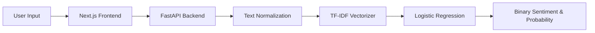

# Sentiment Analyzer NLP

An end-to-end Natural Language Processing (NLP) system comparing a **Classical NLP Baseline** (TF-IDF + Logistic Regression) and a **Transformer NLP Pipeline** (`FacebookAI/roberta-base`), backed by a production-ready **FastAPI** service and an interactive **Next.js** frontend.

---

## Overview

Text sentiment analysis is a core task in NLP with applications ranging from customer feedback monitoring to social media trend analysis. This project implements and contrasts two distinct paradigms of NLP engineering:

1. **V1 — Classical NLP Baseline**: A lightweight, interpretable, and computationally efficient pipeline using n-gram TF-IDF vectorization and Logistic Regression trained on IMDb movie reviews for binary sentiment classification (Positive / Negative). Serviced via a FastAPI REST backend and a Next.js web interface.
2. **V2 — Transformer NLP**: A modern contextual language model leveraging Byte-Pair Encoding (BPE) and bidirectional multi-head self-attention with `FacebookAI/roberta-base` trained on Twitter text (`cardiffnlp/tweet_eval`) for fine-grained 3-class classification (Negative, Neutral, Positive).

By building both pipelines side-by-side within the same engineering framework, the project demonstrates practical trade-offs between computational cost, inference latency, sequence modeling, and representation richness.

---

## Architecture

### V1 — Classical NLP
IMDb → preprocessing → TF-IDF → Logistic Regression → sentiment



### V2 — Transformer NLP
TweetEval → tokenizer → RoBERTa-base → fine-tuning → 3-class sentiment


---

## V1 — Classical NLP Baseline

The V1 pipeline serves as a battle-tested baseline established on the benchmark IMDb movie review dataset.

### Pipeline Details
- **Dataset**: Large Movie Review Dataset (IMDb).
- **Preprocessing**: HTML tag stripping, regex character cleaning, whitespace normalization, lowercase conversion.
- **Feature Extraction**: Term Frequency-Inverse Document Frequency (TF-IDF) capturing unigrams and bigrams, filtering rare vocabulary.
- **Classifier**: Logistic Regression with L2 regularization optimized via cross-entropy loss.
- **Model Artifact**: Serialized scikit-learn pipeline saved at `ml/models/sentiment_pipeline.pkl`.
- **Serving**: FastAPI asynchronous REST API loaded once into memory on server startup via a lifespan context manager.
- **Verified Benchmark**:
  - **Accuracy: 89.92%** on the unseen 25,000-example IMDb test set.

### Inherent Limitations of the Classical Baseline
- **Bag-of-Words Limitation**: TF-IDF treats n-grams as sparse discrete counts, ignoring long-range token relationships and global word order.
- **Lack of True Context**: Words receive static scores regardless of contextual syntax (for instance, *"not bad"* vs *"bad"* relies heavily on bigram capture).
- **Negation and Sarcasm Sensitivity**: Complex clause structures, rhetorical shifts, and inverted meanings are difficult to parse without hierarchical sequence models.
- **Binary Restriction**: Movie reviews are polarized into positive and negative, leaving neutral or ambiguous statements unrepresented.

---

## V2 — Transformer NLP

The V2 pipeline introduces modern contextual representations using self-attention and transfer learning.

**Current Pipeline Status: Full GPU fine-tuning is pending.**

Local development was performed on an **AMD Ryzen 7 5700U CPU** with **AMD Radeon integrated graphics** and **14 GB RAM**. Because CUDA is not available on this machine, the entire pipeline was rigorously validated through a lightweight 10-step local smoke test, while multi-epoch training is targeted for Google Colab GPU.

### Pipeline Details
- **Benchmark**: Cardiff NLP TweetEval Sentiment (`cardiffnlp/tweet_eval`, config: `sentiment`).
- **Target Classes**: 3 fine-grained categories:
  - `0` = Negative
  - `1` = Neutral
  - `2` = Positive
- **Pretrained Architecture**: `FacebookAI/roberta-base` (12 encoder layers, 768 hidden dimensions, 12 attention heads, 125M parameters).
- **Representation Mechanism**: Unlike static embeddings, multi-head self-attention enables each token representation to dynamically incorporate information from every other token in the sequence based on the surrounding context. Rather than "understanding" language like a human, the model constructs high-dimensional statistical representations conditioned on surrounding bidirectional context.
- **Classification Head**: Extracts the sequence-level contextual embedding of the initial `<s>` token, routes it through a dense layer with tanh activation, and projects down to 3 unnormalized logits via a linear layer.
- **Dynamic Padding**: Batched sequences are truncated at `MAX_LENGTH = 128` without static dataset padding. At training time, `DataCollatorWithPadding` dynamically pads mini-batches to the maximum length in that specific batch, saving substantial compute and memory.

---

## Dataset

| Dataset | Pipeline | Classes | Train Split | Validation Split | Test Split | Task Domain |
| :--- | :--- | :---: | :---: | :---: | :---: | :--- |
| **IMDb Movie Reviews** | **V1 (Classical)** | 2 | 24,781 *(cleaned)* | None | 25,000 | Long-form film reviews |
| **TweetEval Sentiment** | **V2 (Transformer)** | 3 | 45,615 | 2,000 | 12,284 | Short-form social tweets |

### Data Preparation Notes
- **IMDb (V1)**: The raw dataset was systematically audited and cleaned. Duplicate reviews and exact overlaps between training and test sets were purged to prevent data leakage, yielding 24,781 strictly unique training reviews and 25,000 test reviews.
- **TweetEval (V2)**: The official Cardiff NLP splits are downloaded directly through Hugging Face Datasets. An integrity audit verified zero missing texts, zero null labels, zero split leakage (train intersection val = 0, train intersection test = 0), and a maximum training sequence length of 93 RoBERTa tokens (comfortably bounded by `MAX_LENGTH = 128`).

---

## Model Comparison

| Feature / Dimension | V1 Pipeline (Classical NLP) | V2 Pipeline (Transformer NLP) |
| :--- | :--- | :--- |
| **Model** | Logistic Regression | RoBERTa-base (`FacebookAI/roberta-base`) |
| **Representation** | TF-IDF (Sparse n-gram vectors) | Contextual Transformer representations (768-D) |
| **Classes** | 2 (Negative, Positive) | 3 (Negative, Neutral, Positive) |
| **Dataset** | IMDb Movie Reviews | TweetEval Sentiment (`cardiffnlp/tweet_eval`) |
| **Context** | Limited (Bag-of-words / n-grams) | Contextual (Bidirectional self-attention) |
| **Training** | Classical ML (Trained from scratch) | Transformer fine-tuning (Transfer learning) |
| **Primary Metric** | Accuracy | Macro F1 (Unweighted class average) |
| **Serving Integration** | Integrated in FastAPI and Next.js | Standalone inference validated; backend integration pending |

*(Note: Final V2 performance numbers will be recorded after Google Colab GPU fine-tuning).*

---

## Project Structure

```
Sentiment-Analyzer-NLP/
├── app/                                  # Next.js App Router frontend
│   ├── globals.css                       # Global styles and Tailwind directives
│   ├── layout.tsx                        # Root HTML shell
│   └── page.tsx                          # Interactive sentiment analysis dashboard
├── components/                           # Modular React UI components
│   ├── AnalysisResult.tsx                # Classification display and score card
│   ├── ConfidenceBar.tsx                 # Real-time confidence visualizer
│   ├── HistoryTable.tsx                  # Local prediction history table
│   └── ...
├── lib/                                  # Frontend client helpers and API connector
│   └── api.ts                            # REST client for FastAPI backend
├── types/                                # TypeScript interfaces and response schemas
├── backend/                              # FastAPI backend (serves V1)
│   ├── main.py                           # REST endpoints (/predict, /health) with lifespan model loading
│   ├── requirements.txt                  # Backend server dependencies
│   └── README.md                         # Backend API documentation
├── ml/                                   # Classical NLP module (V1)
│   ├── data/                             # Scaffolding for local IMDb data
│   ├── models/                           # Serialized sentiment_pipeline.pkl
│   └── src/                              # Cleaning, TF-IDF, training, and evaluation scripts
├── ml_transformer/                       # Transformer NLP module (V2)
│   ├── README.md                         # Transformer architecture docs and Colab GPU guide
│   ├── requirements.txt                  # Deep learning and Hugging Face dependencies
│   ├── data/                             # Reserved for transformer data caching
│   ├── models/                           # Reserved for saved fine-tuned checkpoints
│   ├── outputs/                          # Training logs and checkpoint metadata
│   └── src/
│       ├── config.py                     # Centralized hyperparameters, paths, and random seed
│       ├── load_dataset.py               # Official TweetEval dataset loader
│       ├── explore_dataset.py            # Token length distributions and integrity checker
│       ├── tokenize_data.py              # Batched RoBERTa tokenization and inspection
│       ├── train.py                      # HF Trainer pipeline with GPU/CPU safeguards
│       └── test_model.py                 # Standalone inference using real logits and softmax
├── .gitignore                            # Ignore rules (excluding datasets, .venv, caches, models)
├── package.json                          # Next.js project definition
└── tsconfig.json                         # TypeScript compiler configuration
```

---

## Installation

### Prerequisites
- Python 3.10+ (tested on Python 3.13)
- Node.js 18+ and npm

### 1. Clone the Repository
```bash
git clone https://github.com/Aditya-sync/Sentiment-Analyzer-NLP.git
cd Sentiment-Analyzer-NLP
```

### 2. Python Virtual Environment Setup
```bash
python3 -m venv .venv
source .venv/bin/activate
```

### 3. Install V1 (Classical & Backend) Dependencies
```bash
pip install -r backend/requirements.txt
```

### 4. Install V2 (Transformer Pipeline) Dependencies
```bash
pip install -r ml_transformer/requirements.txt
```

### 5. Install Next.js Frontend Dependencies
```bash
npm install
```

---

## V1 Usage

### Step 1: Run Classical Pipeline Training / Verification
```bash
python ml/src/train_model.py
```

### Step 2: Start the FastAPI Backend
```bash
uvicorn backend.main:app --reload --port 8000
```
- Interactive Swagger API docs: `http://localhost:8000/docs`
- Health check: `http://localhost:8000/health`

### Step 3: Start the Next.js Frontend
In a separate terminal:
```bash
npm run dev
```
Open `http://localhost:3000` in your browser to interact with the web interface.

---

## V2 Transformer Pipeline

The V2 module is isolated in `ml_transformer/` and designed for execution across local development and Google Colab GPUs.

### 1. Dataset Loading
Loads official `cardiffnlp/tweet_eval` splits directly from Hugging Face:
```bash
PYTHONPATH="." python ml_transformer/src/load_dataset.py
```

### 2. Dataset Exploration & Token Length Analysis
Calculates sequence metrics and verifies integrity (missing values, duplicates, split overlaps):
```bash
PYTHONPATH="." python ml_transformer/src/explore_dataset.py
```

### 3. Batched Tokenization
Applies fast BPE tokenization with sequence length inspection on canonical test sentences:
```bash
PYTHONPATH="." python ml_transformer/src/tokenize_data.py
```

### 4. Local Smoke Test (Validation Without Full CPU Training)
A lightweight 10-point technical validation verifies data collation, logits shape `(batch_size, 3)`, loss calculation, backpropagation, and training arguments in approximately 5 seconds:
```bash
PYTHONPATH="." python ml_transformer/src/train.py --smoke-test
```

### 5. Full GPU Fine-Tuning on Google Colab
Full 4-epoch fine-tuning is targeted for a **Google Colab T4 GPU** (approximately 12 minutes):

1. Open Google Colab and set Runtime to **T4 GPU**.
2. Clone this repository and install dependencies:
   ```bash
   pip install -r ml_transformer/requirements.txt
   ```
3. Run full fine-tuning:
   ```bash
   PYTHONPATH="." python ml_transformer/src/train.py --full-train
   ```
4. Download the saved model artifact from `ml_transformer/models/roberta-tweeteval/`.

### 6. Standalone Inference
Run sentiment inference with real forward-pass logits and softmax probabilities:
```bash
PYTHONPATH="." python ml_transformer/src/test_model.py
```

---

## Evaluation

Model performance is evaluated using standardized classification metrics:

- **Accuracy**: Overall fraction of correct predictions across all classes.
- **Macro F1**: Unweighted arithmetic mean of F1 scores across all three classes:
  $$\text{Macro F1} = \frac{F1_{\text{negative}} + F1_{\text{neutral}} + F1_{\text{positive}}}{3}$$
  *Why Macro F1 is the primary V2 metric*: In TweetEval, neutral tweets form the majority (approximately 45%), while negative tweets represent approximately 15% of training samples. Overall accuracy would reward a model that heavily favors the majority class. Macro F1 forces the model to perform well on underrepresented classes.
- **Weighted F1**: Class F1 scores weighted by true class support.
- **Precision & Recall**: Evaluated both per-class and as macro averages.
- **Confusion Matrix**: Maps predicted classes against true classes across Negative (0), Neutral (1), and Positive (2) to identify specific misclassification patterns.

---

## Current Status

### V1 — Classical NLP
- [x] Dataset exploration
- [x] Data cleaning
- [x] TF-IDF
- [x] Logistic Regression
- [x] Evaluation
- [x] FastAPI
- [x] Next.js

### V2 — Transformer NLP
- [x] Dataset inspection
- [x] Tokenization
- [x] RoBERTa loading
- [x] Training pipeline
- [x] Local smoke test
- [x] Validation strategy
- [x] Test-set isolation
- [x] Model saving pipeline
- [ ] Full GPU fine-tuning
- [ ] Final test evaluation
- [ ] FastAPI integration
- [ ] Next.js integration

---

## Future Improvements

- **Side-by-Side Model Comparison**: Head-to-head benchmarking of V1 (TF-IDF) vs V2 (RoBERTa) on ambiguous, negated, and neutral sentences.
- **Dual-Model API**: Extend FastAPI to expose both `/predict/v1` and `/predict/v2` endpoints.
- **Frontend Model Switcher**: Add an interactive toggle in Next.js allowing users to compare classical vs Transformer predictions in real time.
- **Error Analysis & Interpretability**: Integrated attention map visualization or saliency maps to identify token-level influence.
- **Containerization & Deployment**: Dockerize the application for unified deployment on cloud container platforms.

---

## Disclaimer & Reproducibility

- **Data Integrity**: All performance numbers reported in this project (e.g., V1 89.92% accuracy) represent measured test-set evaluations. No unverified, simulated, or placeholder numbers are reported for V2.
- **Evaluation Isolation**: The test split for both V1 and V2 is strictly sequestered from training and model selection. Macro F1 model selection for RoBERTa relies exclusively on the validation split.
- **Deterministic Execution**: Experiments use a fixed random seed (`SEED = 42`) across Python, NumPy, PyTorch, and Hugging Face Transformers for reproducible runs.
